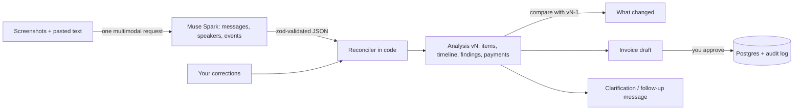

# Traccoon PayAgent

Filipino freelancers and small businesses agree work in Messenger and Viber chats: a price here, an add-on there, "bayad ko end of the month", a cancellation a week later. When it's time to bill, nobody remembers exactly what was agreed.

PayAgent reads the screenshots of those conversations and reconstructs the money side of the relationship: what was agreed, what changed, what was cancelled, what was promised or claimed as paid, and what is still unclear. **Every conclusion links back to the message it came from**, and nothing is billed until you approve it.

- **Live demo:** _add the Vercel URL_
- **Video (3 min):** _add the video link_
- Built for the Meta Global AI Developer Hackathon, Indie Developer track ("Build for Your World")

## What it does

1. **Start an investigation.** Upload several chat screenshots (or paste text), put them in order, and optionally ask a question: "How much does Ana owe me?"
2. **Muse Spark reads the whole conversation.** It transcribes each message, works out who said it (you or the client), and tags the financial events: offers, counteroffers, acceptances, scope changes, cancellations, payment promises and payment claims.
3. **Code reconstructs the agreement.** A deterministic engine turns those events into line items with a status: agreed, change proposed, cancelled or disputed. It builds a timeline and flags contradictions. Payments are kept in separate buckets: *promised*, *claimed*, *documented* and *verified*. A client saying "I already paid ₱4,000" is a claim, not a payment.
4. **Add evidence later and see what changed.** When the client cancels part of the job, upload the new screenshot. PayAgent re-analyses everything and shows a diff against the previous version: "Admin dashboard: agreed → cancelled. Agreed total: ₱18,000 → ₱15,000". Every version is kept and can be opened read-only.
5. **Fix what it got wrong.** Mark a sender as wrong, correct an amount, confirm or reject an inferred agreement. Corrections are re-applied on every later analysis, and they show as "confirmed by you", never as something the chat said.
6. **Act on it.** Draft an invoice from the agreed items (cancelled and disputed items are left out, with a warning naming them), copy a clarification or follow-up message for the client, or save a summary. Each invoice links back to the analysis version it came from.

The original invoice agent is still there at `/new`: describe a job in Taglish, record a voice note, or upload a single screenshot, and get a draft invoice.

## How it uses Meta's models

| Model | Used for |
| --- | --- |
| **Muse Spark 1.3, vision** (`muse-spark-1.3`) | Investigations. Up to 8 screenshots and pasted text go in one multimodal request, labelled E1, E2 and so on. The model returns structured JSON, validated with zod: messages with speaker and source, financial events that point to message ids, and anything it couldn't read. Temperature 0, one automatic retry on invalid output. |
| **Muse Spark 1.3, tools** | The invoice agent at `/new`. Function calling with 4 tools in a loop of up to 5 rounds. |
| **Muse Voice Transcribe 1.0** (`muse-voice-transcribe-1.0`) | Voice notes. The browser converts the recording to the 16 kHz mono WAV the API requires and sends it to `/v1/asr/transcribe`. |

**The model reads, code decides, you approve.** The split is strict:

| The model does | Code does |
| --- | --- |
| Transcribe messages and attribute speakers | Parse every amount into integer centavos (BigInt), including "3k", "₱15,000" and "tatlong libo" |
| Tag each event with its type and the raw amount text | Resolve dates in Asia/Manila |
| Point each event at the messages that support it | Decide each item's status, the totals and the balance |
| | De-duplicate overlapping screenshots, compute the diff between versions |
| | Downgrade weak conclusions: an "acceptance" from the same person who proposed the price is marked *inferred* and sent for review |

That split is why a wrong reading can be traced and corrected. The answer is never a number the model made up.



## Trust, safety and privacy

- **Evidence behind every amount.** Each finding and timeline entry opens the screenshot it came from, with the message highlighted when the model's position for it passes sanity checks.
- **Payments are never assumed.** A payment claim in a chat is shown as claimed and unverified. Nothing in this version marks money as received.
- **Prompt injection is treated as data.** Text inside a screenshot is evidence, never instructions.
- **Nothing is billed without approval.** Approving is idempotent and transactional. One draft can create only one invoice.
- **Failed analyses don't overwrite good ones.** If the model call fails, the previous version stays and you can retry.
- **Login.** The deployed app needs a password (`APP_PASSWORD`, signed httpOnly session cookie). Without one set, it runs open and shows a "Test data only" badge.
- **Deletion.** Deleting an investigation removes its screenshots, text and every analysis version. The audit log keeps only the fact that it was deleted, not the content.
- **Disclosure.** Every page says that evidence is sent to Meta's Model API and stored until you delete it.
- **Append-only audit log** for every analysis, correction, draft and approval, shown on the Activity page.

## Evaluation

- `pnpm eval:investigations` runs the staged conversations in `evals/investigations/` through the real model and the reconciler:
  - Ana, screenshots 1 and 2: website and dashboard are both agreed, total ₱18,000.
  - Ana, plus the cancellation screenshot: the dashboard is cancelled, total ₱15,000.
  - Ben: the price is under dispute (₱8,000 offered, ₱7,000 claimed), the ₱4,000 payment is claimed but not verified, and the recommendation is to ask for clarification.
- `pnpm eval` runs 18 invoice-agent cases (English, Filipino, Taglish, aliases, USD, missing fields, prompt injection, 3 screenshots).
- `pnpm test` runs 128 unit tests, including the reconciler: duplicates, self-acceptance, cancellation after completion, the version diff and corrections.

Latest real-model results on Muse Spark 1.3 (3 Nov 2026): investigations **3/3** (23 to 54 s per case), invoice agent **17/18** on the full run, with the one miss (a client alias) passing on rerun. `pnpm smoke` passes all five checks, including Muse Voice Transcribe.

## Built during the Meta hackathon

All code in this repository was written on 3–4 Nov 2026 (Philippine time), inside the hackathon building period (27 Oct to 4 Nov 2026). The git history is the record: from the first commit `9e3e1e3` ("Foundation: scaffold, tokens, schema, money and date core") to the commit tagged `meta-submission`. Nothing was carried over from an earlier project.

The product changed direction during the hackathon. It started as a chat-to-invoice agent (now `/new`). On 3 Nov it became conversation investigations, following the PRD in [`docs/PRD-conversation-intelligence.md`](docs/PRD-conversation-intelligence.md).

## Run it locally

You need Node 20+, pnpm, a Postgres database (Neon works), and a Meta Model API key.

```bash
pnpm install
cp .env.example .env.local
```

Fill in `DATABASE_URL` and `META_API_KEY` in `.env.local`. Leave `APP_PASSWORD` blank to run without login. Then run:

```bash
pnpm db:migrate
pnpm db:seed
pnpm smoke
pnpm dev
```

`pnpm smoke` checks a plain completion, a tool call, screenshot reading, transcription and the database. Open http://localhost:3000 and start an investigation with the screenshots in `evals/investigations/`.

Other scripts: `pnpm eval`, `pnpm eval:investigations`, `pnpm test`, `pnpm typecheck`, `pnpm lint`, `pnpm build`.

## Stack

Next.js 15 (App Router) · TypeScript · Tailwind CSS v4 with Traccoon design tokens · Drizzle ORM on Neon Postgres · Meta Model API through the OpenAI-compatible SDK · zod · Vitest

## Project layout

- `src/lib/investigation/`: extraction prompt and schema, the reconciler (statuses, totals, findings, diff), and the message drafts
- `src/lib/investigations.ts`: evidence, analysis versions, corrections and invoice drafts in the database
- `src/lib/ai/`: the invoice agent loop, tools, model provider and transcription client
- `src/lib/money.ts`, `src/lib/amount-words.ts`, `src/lib/dates.ts`: deterministic parsing of amounts and dates
- `src/lib/session.ts`, `src/middleware.ts`: login
- `src/app/`: Workspace, Investigations, Invoices and Activity screens, and their server actions
- `evals/`: staged conversations, invoice cases, test screenshots and a sample voice note
- `docs/`, `tasks.md`: product requirements and the build plan

## What's next

The agreed totals become PayPal payment requests with webhook reconciliation, so a *claimed* payment can become *verified* (PayPal AI Hackathon). After that, private payment proofs on Stellar with Noir (Noir × Velo).

## License

MIT
